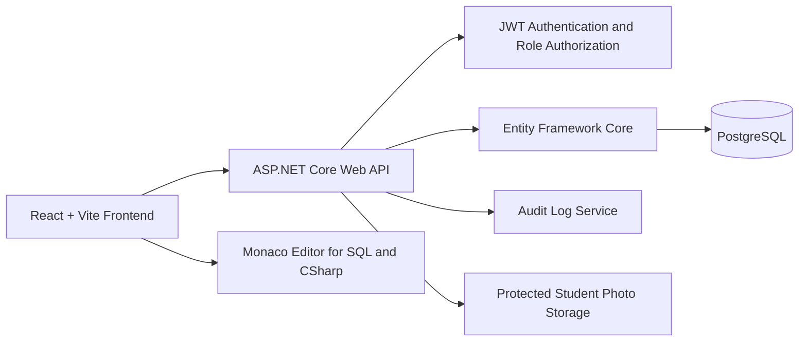
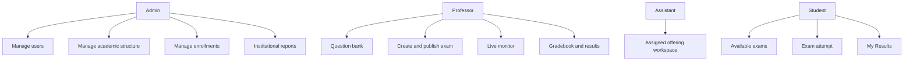
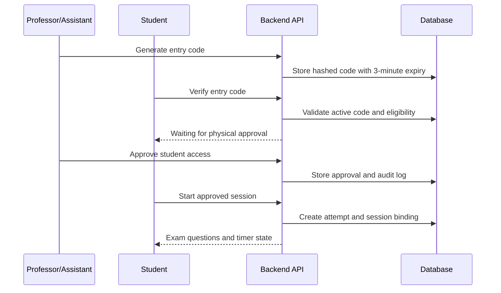
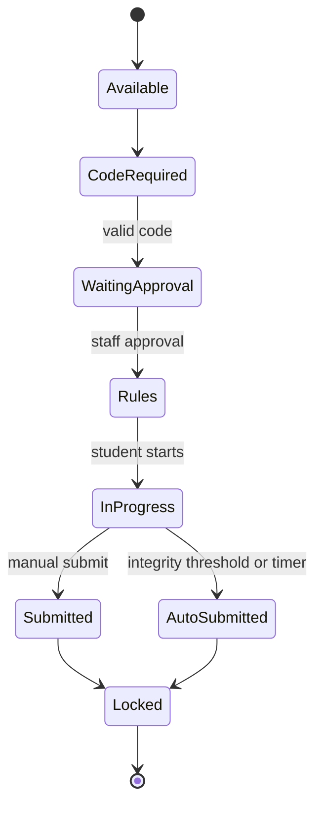
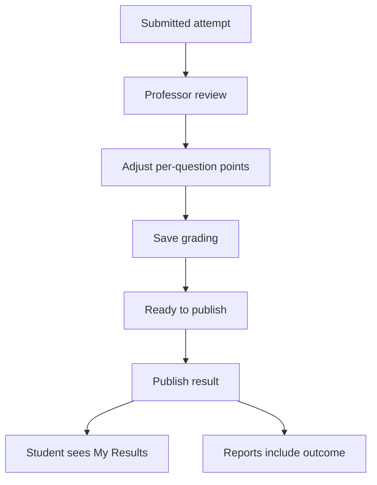
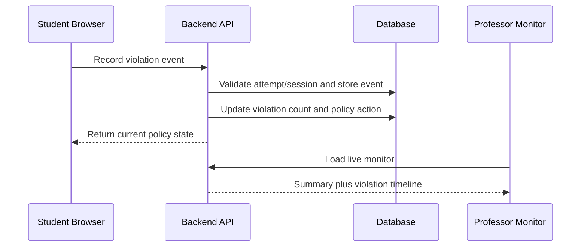
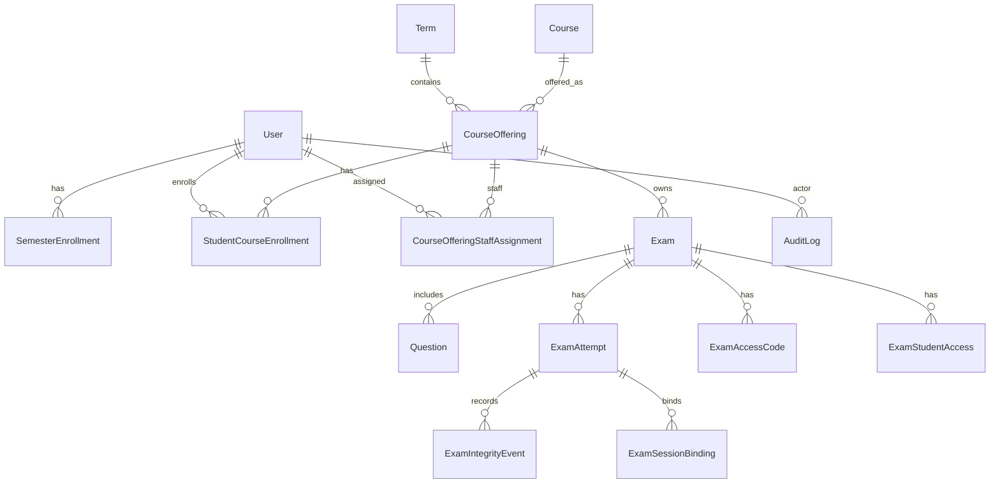

# Week 9 - Entities and Diagrams

## Main Database Entities

### User

Represents an authenticated system account. Important fields include role, full name, email, password hash, activation state, student number, and official photo metadata.

Security relevance: role controls navigation and backend authorization. Password hash must never be exposed.

### Term

Represents an academic term/year. Course offerings belong to terms.

### Course

Represents a catalog course such as Programming, Databases, or Algorithms.

### CourseOffering

Represents a concrete course instance for a term, academic year, semester, section, professor, and assistant context.

Security relevance: most professor/assistant permissions and student visibility are scoped through offerings.

### CourseOfferingStaffAssignment

Stores professor/assistant assignment history for an offering.

Security relevance: used to decide which staff member can manage or monitor an offering.

### SemesterEnrollment

Represents a student's enrollment in a term/semester.

### StudentCourseEnrollment

Represents a student's eligibility for a specific course offering.

Security relevance: controls whether the student can see and enter an exam.

### Question

Represents either an exam question or a reusable question-bank item. Supports MCQ, text, SQL, and C# questions.

Important fields: text, type, options, correct answer, points, topic, difficulty, metadata JSON, exam link.

Security relevance: student-facing exam DTOs must not expose private model answers or hidden grading metadata.

### Exam

Represents an academic assessment. Contains schedule, duration, status, maximum points, course offering, publication state, academic metadata, and access settings.

Security relevance: draft exams are hidden from students; published exams still require eligibility and access control.

### ExamAccessCode

Stores hashed temporary entry codes for an exam.

Important fields: exam, code hash, generated by, generated at, expires at, active/revoked state.

Security relevance: plain reusable codes are not stored permanently.

### ExamStudentAccess

Tracks one student's admission state for an exam.

Important fields: access status, verified at, approved by, approved at, reason, last activity.

Security relevance: a valid code moves the student to waiting state; approval is required before the session.

### ExamAttempt

Stores one student's exam attempt.

Important fields: started at, submitted at, answers JSON, score fields, grading state, published state, question order/version, integrity policy state.

Security relevance: submitted attempts are locked from further student modification.

### ExamSessionBinding

Binds an attempt to a client session reference.

Security relevance: supports concurrent session rejection, device-change approval, revoked sessions, and stale/disconnected state.

### ExamIntegrityEvent

Stores integrity/proctoring events such as fullscreen exit, blur, tab switch, copy/paste attempt, back navigation, network offline, and camera warnings.

Security relevance: supports professor review, auto-submit policy, and audit evidence.

### AuditLog

Stores important system actions with actor, entity, scope, timestamp, and details.

Security relevance: supports traceability for academic and administrative decisions.

## System Architecture Diagram

## Role-Based Workflow Diagram

## Exam Access Flow

## Student Exam Lifecycle

## Grading and Result Publication

## Integrity Event Flow

## Database Relationship Overview

